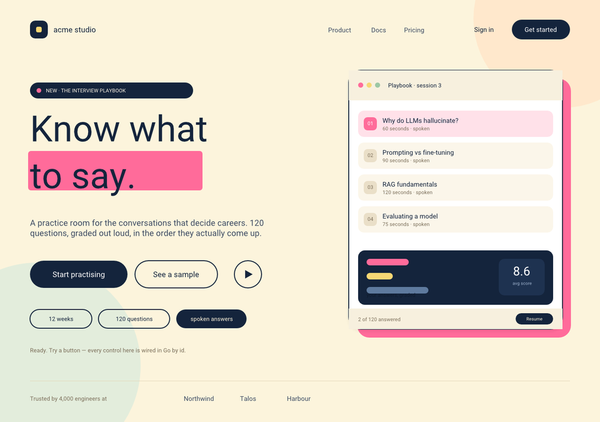
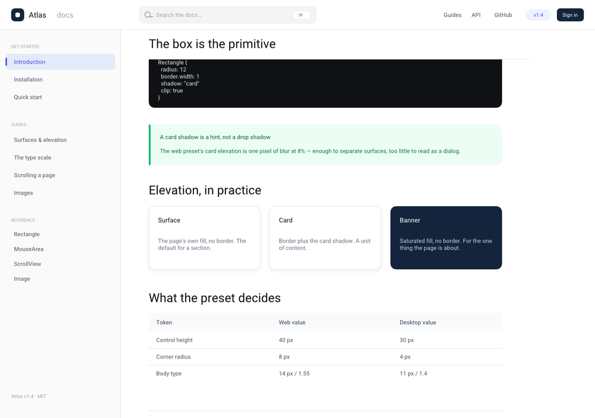
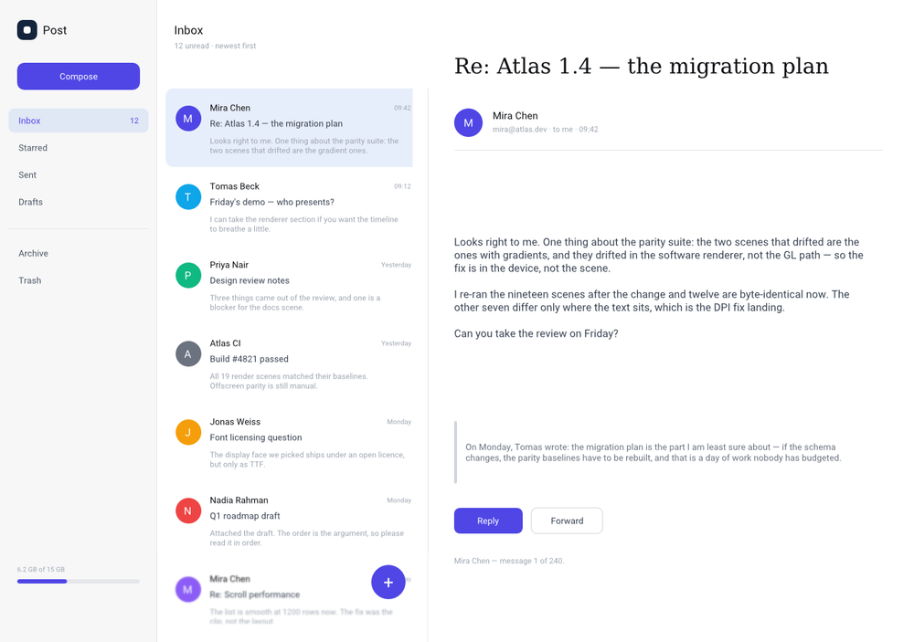
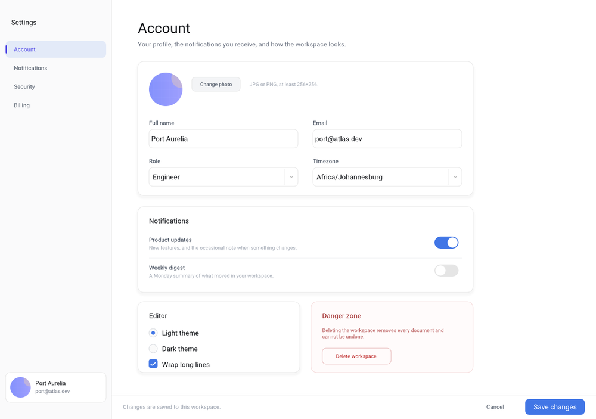

# MeUI

**QML declares the surface. Go decides what it does.**

[](https://go.dev)
[](LICENSE)
[](#quick-start)



MeUI is a Go widget toolkit for **web-looking pages** and **desktop consoles**. Scenes are
written in QML as a *builder*, not a language: no expressions, no bindings, no JavaScript.
Every behaviour — a click, a selection, a scroll, a validation — is attached from Go, by
id, so the logic is typed, testable and debuggable while the layout stays declarative.

The same scene renders through a software device (headless, deterministic) or OpenGL
(through [mobilegles](https://github.com/sixnineone/mobilegles)), which is what makes the
screenshots and the pixel tests in this repository possible.

## Why MeUI

- **QML that can't lie.** The QML is data, not code. Ids are resolved when the scene is
  built, so a typo is an error at startup, not a handler that silently never runs. There
  is no second place for state to hide: behaviour lives in Go, next to the rest of the app.
- **Web pages *and* consoles.** Sticky headers, breakpoints, virtual lists and frosted
  glass on one side; menubars, typed tables, trees, inspectors and a navigation rail on the
  other. One widget set, two idioms.
- **One drawing seam.** Soft and GL devices draw the same primitives. The render-parity
  harness renders a scene through both and diffs the frames, so the two backends cannot
  drift apart unnoticed.
- **Deterministic screenshots.** Every example runs headless with `-shot out.png`; the
  behaviour harness asserts layout, hit-testing and painting without a display, and the
  visual harness asserts real pixels in a real window.
- **A toolkit you can theme.** 8 presets (`web-light`, `web-dark`, iOS, Android, harness)
  plus 52 importable IntelliJ-style theme files, with per-widget overrides.
- **No cgo in the desktop build.** Control reaches SDL3 and OpenGL through purego, so the
  dev loop is plain `CGO_ENABLED=0 go run`.

## Quick start

Requires Go 1.25.

```sh
git clone https://github.com/sixnineone/meui
cd meui
CGO_ENABLED=0 go run ./examples/launcher
```

The launcher lists every example; each one also runs on its own and every one can render a
frame without a display:

```sh
CGO_ENABLED=0 go run ./examples/docs                 # a real window, real input
CGO_ENABLED=0 go run ./examples/docs -shot docs.png  # the same scene, headless
```

## A scene, a page of Go

Save this as `hello.qml`. Note what is *not* there: no `onClicked`, no bindings, no
JavaScript. It is a description of a surface.

```qml
Window {
  width: 720
  height: 480
  color: "#F7F5F0"

  Rectangle {
    anchors.fill: parent
    color: "#F7F5F0"

    Text {
      id: title
      x: 40
      y: 44
      width: 480
      height: 48
      text: "Hello, MeUI"
      font.pixelSize: 28
      font.weight: 700
      color: "#0F1115"
    }

    Rectangle {
      id: card
      x: 40
      y: 112
      width: 300
      height: 120
      radius: 12
      color: "#FFFFFF"
      border.width: 1
      border.color: "#E5E0D6"
      shadow: "card"
      clickable: true

      Text {
        x: 20
        y: 20
        width: 260
        height: 24
        text: "A card is a Rectangle"
        font.pixelSize: 12
        font.weight: 600
        color: "#0F1115"
      }
    }

    Button {
      id: cta
      x: 40
      y: 260
      width: 160
      height: 44
      text: "Say hello"
    }
  }
}
```

The behaviour is the Go file:

```go
package main

import (
	"log"

	"github.com/sixnineone/meui"
	"github.com/sixnineone/meui-gl/sdl3"
	"github.com/sixnineone/meui/graphics"
	"github.com/sixnineone/meui/web"
	"github.com/sixnineone/meui/widgets"
)

func main() {
	scene, err := web.Load("hello.qml", "web-light", 720, 480)
	if err != nil {
		log.Fatal(err)
	}

	// The scene declared the surface; Go decides what it does.
	scene.Get("cta").(*widgets.Button).SetOnClicked(func() {
		scene.SetText("title", "Hello, Go.")
	})
	scene.OnClick("card", func() {
		scene.SetText("title", "The card was clicked.")
	})

	root := scene.Root.(*meui.Window)
	app := meui.NewApp(sdl3.NewApp(), meui.AppOptions{Title: "Hello"})
	if _, err := app.AddWindow(root, meui.WindowOptions{
		Title: "Hello",
		Size:  graphics.NewSize(720, 480),
	}); err != nil {
		log.Fatal(err)
	}
	if err := app.Run(); err != nil {
		log.Fatal(err)
	}
}
```

`scene.Shot(720, 480, "hello.png")` renders the same tree without opening a window.

## Features

**Layout and surfaces**
- `VStack`, `HStack`, `Grid`, `Flex`, anchors and size policies
- Rounded corners, borders, offset and soft shadows, gradients, clipping
- Opacity, z-order, backdrop blur ("frosted glass"), sticky headers
- Responsive breakpoints and per-breakpoint layout overrides

**Scrolling and data**
- `ScrollView` / `ScrollPane` with wheel, drag and scroll bars
- `VirtualList` — thousands of rows, only the visible widgets exist
- Typed `DataTable` (columns, sorting, selection, column resize), `Tree`, `ListView`
- Sticky sections inside long pages

**Input**
- Click, hover, press, drag, wheel and keyboard focus, wired by id
- `MouseArea`, context menus, tooltips, dialogs, bottom sheets, action sheets

**Forms**
- `TextField`, `ComboBox`, `CheckBox`, `RadioButton`, `Switch`, `Slider`, `SpinBox`
- `ProgressBar`, `DatePicker`, `Calendar`, `ColorPicker`, validation states and error rings

**Chrome**
- `MenuBar`, `StatusBar`, `NavigationRail`, tabs (`TabPanel`), `SplitView`, `DockPanel`
- Desktop-style window chrome with minimize/maximize/close

**Text and graphics**
- Wrapped and elided labels, `MarkdownView`, `MarkdownEditor`, `CodeEditor`
- Images (cover/contain, rounded, clipped), SVG icons, paths and strokes

**Rendering and testing**
- Software device for headless, deterministic rendering
- OpenGL renderer (`mobilegles`) with the same primitive set
- Headless behaviour suite, windowed visual suite, render-parity harness, `imgdiff`

## Gallery

<table>
  <tr>
    <td width="50%"><br><sub><b>dashboard</b> — gradients, translucent cards, a box chart</sub></td>
    <td width="50%"><br><sub><b>docs</b> — fixed top bar and sidebar, a 1,880px article, a sticky header</sub></td>
  </tr>
  <tr>
    <td width="50%"><br><sub><b>docs</b> — the sticky header after scrolling</sub></td>
    <td width="50%"><br><sub><b>mail</b> — a virtual list of 240 messages, frosted header</sub></td>
  </tr>
  <tr>
    <td width="50%"><br><sub><b>checkout</b> — a three-step flow with inline validation</sub></td>
    <td width="50%"><br><sub><b>settings</b> — web-styled fields, switches, a toast</sub></td>
  </tr>
  <tr>
    <td width="50%"><br><sub><b>ops</b> — menubar, tree, typed table, inspector, status bar</sub></td>
    <td width="50%"><br><sub><b>admin</b> — dark rail, filters, invite dialog</sub></td>
  </tr>
</table>

## Examples

| example | shows |
|---|---|
| [`landing`](examples/landing) | display type, offset card shadows, pill CTAs |
| [`dashboard`](examples/dashboard) | full-bleed gradients, translucent cards, a chart of boxes |
| [`docs`](examples/docs) | fixed chrome, a scrolling article, a sticky header, a breakpoint |
| [`settings`](examples/settings) | web-styled fields, combo, switches, radios, a toast |
| [`mail`](examples/mail) | a virtual list of 240 messages, selection, a frosted header |
| [`checkout`](examples/checkout) | a three-step flow with inline validation and error rings |
| [`ops`](examples/ops) | a desktop console: menubar, tree, typed table, inspector, status bar |
| [`admin`](examples/admin) | a dark console: navigation rail, filters, invite dialog |
| [`device`](examples/device), [`mobile`](examples/mobile) | phone-shaped pages at device sizes |
| [`enterprise`](examples/enterprise) | the imported QML kitchen sink |
| [`parity`](examples/parity) | the scene the soft and GL devices are diffed on |

Every example takes `-shot`, `-preset`, `-w`, `-h` and `-qml`; [`examples/README.md`](examples/README.md)
documents them all.

## How it fits together

| module | what it is |
|---|---|
| `meui` (this repo) | toolkit: widgets, layouts, QML parser/builder, `web` behaviour layer, theming, examples, harness |
| [`meui-gl`](https://github.com/sixnineone/meui-gl) | SDL3 window/input/platform adapter; hosts a window and runs the frame loop |
| [`mobilegles`](https://github.com/sixnineone/mobilegles) | OpenGL batch renderer for shapes, text and images |

The soft device lives in `meui/graphics`; `mobilegles` is the GL side of the same seam.
`Graphics` primitives, `platform` interfaces and `theme` presets are the contracts between
the three modules.

## Testing

```sh
CGO_ENABLED=0 go test ./...                                  # headless: behaviour, parsing, layout, theming
CGO_ENABLED=0 go test -tags visual ./harness/behaviour/...   # real window, real pixels
make parity-web                                               # soft vs GL on the parity scene
```

`cmd/tools` holds the instruments: `qmlshot` (headless render), `glshot` (GL render),
`imgdiff` (frame diff), `presetgallery` (every preset in one sheet), `qmlfmt`/`qmlverify`
(scene hygiene), `themetool`, `fontprobe` and the determinism checks.

## Documentation

- [`examples/README.md`](examples/README.md) — running, flags, what each example demonstrates
- [`WEB.md`](WEB.md) — the design record: vocabulary, measured references, renderer notes
- [`THIRD_PARTY_NOTICES.md`](THIRD_PARTY_NOTICES.md) — bundled fonts, themes and dependency licences

## Status

**v0.1.0** — pre-1.0, so the API can still move. Linux desktop is the development target;
the SDL3 adapter and the GL renderer are portable, and the adapter carries the Android JNI
surface. Issues and examples of what you are building are welcome.

## Licence

MIT — see [`LICENSE`](LICENSE). The bundled Inter Display faces are SIL OFL 1.1
([`fonts/OFL.txt`](fonts/OFL.txt)); dependency notices are in
[`THIRD_PARTY_NOTICES.md`](THIRD_PARTY_NOTICES.md) and [`LICENSES/`](LICENSES).
